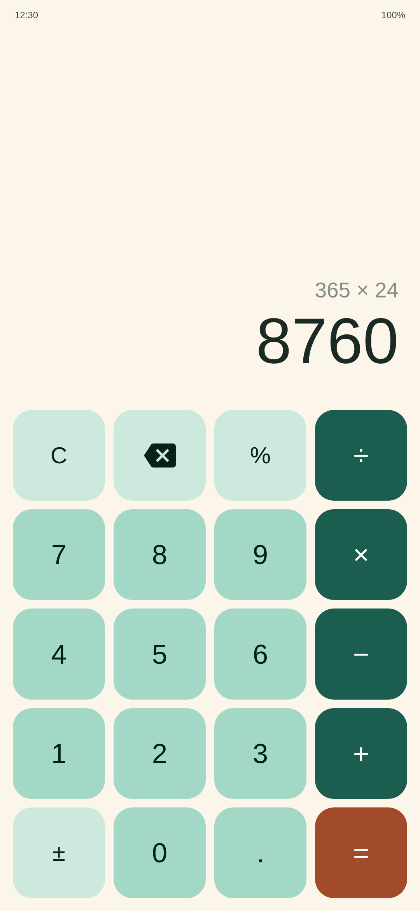
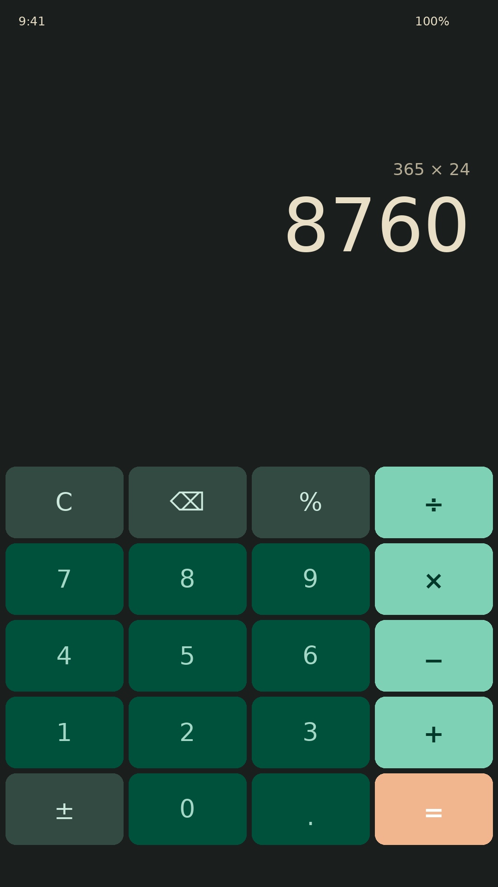

# Pebbo

A small calculator for Android. Material 3, light + dark theme, one Activity, one layout. No ads, no analytics, no internet permission.

## Features

- Four operations plus percent, sign toggle (±), backspace and clear
- Expression preview line above the big result
- Haptic feedback on every key press
- Auto-sizing display with a 12-digit input cap, division by zero shows Error instead of crashing
- Light and dark themes following the system setting
- State survives rotation and process death
- Minified release build, APK stays under 2 MB

## Download

Grab the latest signed APK from the [Releases](https://github.com/luogen520/Pebbo/releases) page.

## Build

```
./gradlew assembleRelease
```

Output APK: `app/build/outputs/apk/release/app-release-unsigned.apk`

## Screenshots

| Light | Dark |
| --- | --- |
|  |  |

## License

GPL-3.0-or-later. See [LICENSE](LICENSE).
